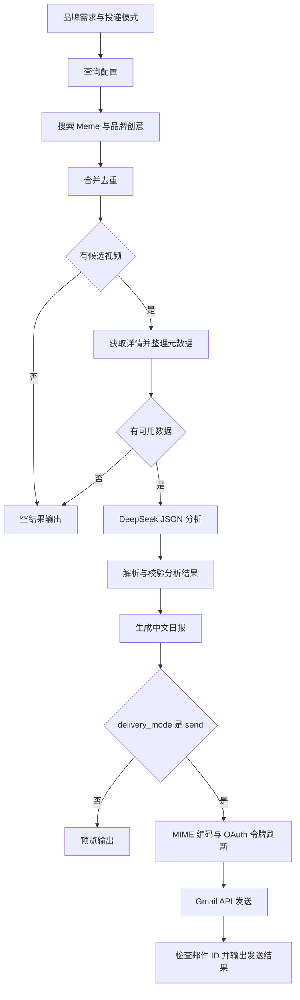

# Dify YouTube 创意选题日报

用 Dify 串联 YouTube Data API、DeepSeek 和 Gmail API：搜索 Meme / 搞笑视频及品牌创意案例，生成保留原视频链接的中文选题日报，并按需发送邮件。

## 功能

- 两路关键词搜索、视频 ID 合并去重，以及视频详情和公开统计信息补齐。
- 根据品牌需求生成主题、推荐理由与低成本改编建议，每类最多保留 5 条推荐。
- 校验模型引用的视频 ID，从原始 API 数据回填标题、频道、链接和统计字段。
- 支持 `preview` 预览与 `send` 投递，输出纯文本、HTML 和 JSON 日报。
- Gmail OAuth 刷新令牌、中文 MIME 邮件编码、发送响应与邮件 ID 检查。

## 流程



## 快速开始

该项目在本地 Docker 部署的 Dify 1.18.0 上完成搭建，维护者已确认原工作流跑通。仓库包含从实际应用导出并清空凭据的 [完整工作流](workflows/youtube_digest.yml)，共 22 个节点。节点源码、提示词和配置说明一并提供。打包时已完成离线检查；在新应用中导入后的运行验证尚未完成，详见 [工作流说明](workflows/README.md)。

1. 在 Dify 工作室选择导入 DSL，上传 `workflows/youtube_digest.yml`，创建新应用。按提示安装 DeepSeek 插件并配置模型供应商凭据。导出使用 `deepseek-flash`、`json_object` 回复格式，关闭思考模式和原生结构化输出，后接 JSON 解析节点；若目标环境没有该模型，需选择可用模型并复测。
2. 在 Google Cloud 启用 YouTube Data API v3 和 Gmail API。按 [Gmail API 接入指南](Gmail_API接入指南.md) 完成发信账号的 OAuth 授权。
3. 按下面的环境变量表在 Dify 的 ENV 面板填写自己的值。`.env.example` 只是字段清单，Dify 不会自动读取本仓库的 `.env` 文件。
4. 导入后节点和连线已包含在工作流内，先使用 [预览输入示例](examples/input.preview.json) 运行。需要理解或调整节点时参阅 [搭建指南](搭建指南.md)。
5. 检查报告和收件邮箱配置后，将 `delivery_mode` 改成 `send`；执行发送分支会真实发信。Gmail 返回邮件 ID 后，再检查已发送邮件和收件箱。

| 环境变量 | 用途 | 建议类型 |
|---|---|---|
| `YOUTUBE_API_KEY` | YouTube API 凭据 | Secret |
| `GMAIL_CLIENT_ID` | OAuth 客户端 ID | Secret |
| `GMAIL_CLIENT_SECRET` | OAuth 客户端密钥 | Secret |
| `GMAIL_REFRESH_TOKEN` | 离线授权刷新令牌 | Secret |
| `GMAIL_SENDER` | 已授权的发件邮箱 | String 或 Secret |
| `GMAIL_RECIPIENT` | 固定收件邮箱 | String 或 Secret |

DeepSeek API Key 在模型供应商中配置，不写入代码或提示词。

## 文件说明

| 文件 | 内容 |
|---|---|
| `01_config.py` | 查询词、时间窗口、UTC 快照时间和 UTC+8 日报日期 |
| `02_collect_ids.py` | 合并搜索结果，保留来源标签并按视频 ID 去重 |
| `03_normalize.py` | 清理 API 元数据，保留缺失统计值，过滤直播 |
| `03b_parse_analysis.py` | 解析模型 JSON 文本并检查顶层结构 |
| `04_render.py` | 校验来源和字段，生成文本、HTML、JSON 日报 |
| `05_build_gmail_message.py` | 中文 MIME 邮件和 Base64URL 请求体 |
| `06_parse_gmail_token.py` | 提取访问令牌，生成完整 Authorization 值 |
| `07_check_gmail_send.py` | 检查 Gmail 响应和邮件 ID |
| `deepseek_system_prompt_json_mode.txt` | JSON 模式提示词，包含字段约束 |
| `deepseek_system_prompt.txt` / `output_schema.json` | 原生结构化输出模式的提示词与 Schema |
| `verify_*.py` | 使用合成数据的离线测试 |
| `workflows/youtube_digest.yml` | 已清空 6 个环境变量值的完整 Dify 工作流 |
| `workflows/README.md` | 导入步骤、版本依赖和验证记录 |

这些 Python 文件是 Dify 代码节点的函数，实际 API 调用由 Dify HTTP 节点完成。它们不是一个独立的命令行发信程序。

## 离线检查

节点代码和测试只使用 Python 标准库。在项目根目录执行：

```bash
python verify_nodes.py
python verify_parser.py
python verify_gmail.py
```

检查覆盖候选去重、缺失统计、引用来源、HTML 转义、推荐数量限制、JSON 解析、中文 MIME、邮箱头校验和 Gmail 响应处理。测试使用合成邮箱和令牌，不调用外部 API、不发送邮件。

仓库提供 GitHub Actions 配置，会在推送和拉取请求中执行这三组检查，不需要配置 API Secrets。

## 配置与扩展

- 默认 Meme 窗口为最近 3 天，品牌创意窗口为最近 30 天，每路最多 20 条候选。查询地区为 `US`，相关语言偏好为 `en`，可在 `01_config.py` 修改。
- 分析依据是标题、简介和公开统计信息；模型没有观看视频，累计播放量不代表当天增长量。
- 当前按单次运行去重。每日定时触发、跨天去重和持久化投递状态属于后续配置，参见搭建指南。
- Gmail 返回 `accepted_by_gmail` 表示接口接受请求，不代替收件确认。发送 HTTP 节点关闭自动重试，超时后先检查已发送邮件。
- 外部 OAuth 应用处于 Testing 状态时，Gmail 刷新令牌通常只有 7 天有效期；长期运行前按 Gmail 指南处理发布状态和重新授权。

## 发布与复用

GitHub 发布步骤见 [GitHub发布指南](GitHub发布指南.md)。导出的 DSL 应排除 Secret 值，并清空实际邮箱、调试数据和硬编码凭据后再提交。原始导出可暂放在被 Git 忽略的 `private/` 文件夹中；网页手动上传时仍需自行排除该文件夹。

单独复用 Gmail 投递部分的方法见 [Gmail API 接入指南第 11 节](Gmail_API接入指南.md#11-封装为gmail-邮件投递工作流工具)。
